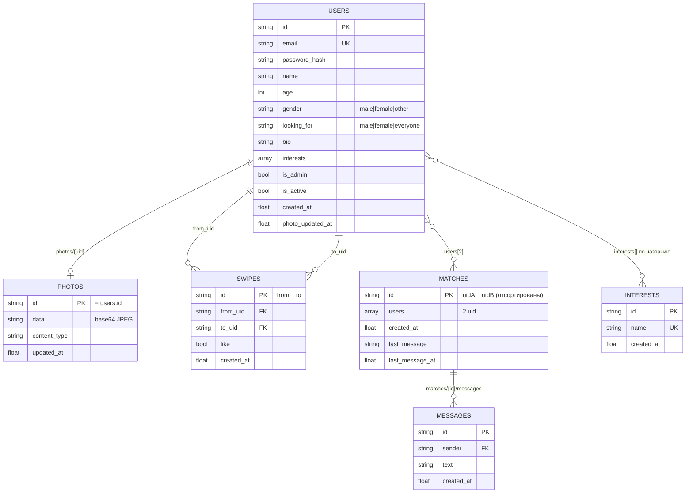

# Этап 1. ТЗ, архитектура, схема БД, API — «DateMatch»

## 1. Цель
Сайт знакомств (упрощённый Tinder): пользователь создаёт анкету с фото, листает чужие анкеты, ставит лайк/дизлайк.
Если два человека лайкнули друг друга — появляется пара и открывается чат.

## 2. Стек
| Слой | Технология | Зачем |
|---|---|---|
| Бэкенд | Python 3.12, Django 5 | маршруты, шаблоны, сессии, CSRF, JSON API |
| База данных | Firebase Firestore (firebase-admin) | NoSQL-коллекции, бесплатный тариф Spark |
| Фронтенд | Django-шаблоны + чистый JS (fetch) | без сборки, быстро открывается на телефоне |
| Авторизация | Сессии (подписанные cookie) + PBKDF2-SHA256 | вариант «сессии» из задания |
| Хостинг | Render (free web service) | Django + статика одним сервисом |

Решения, которые стоит озвучить на защите:
* Классической БД Django нет (`DATABASES = {}`) — все данные в Firestore, сервер ходит туда по Admin SDK, браузер напрямую в Firebase не ходит (правила закрывают всё).
* Фото лежат в Firestore (сжатый JPEG ~60–120 КБ в base64, коллекция `photos`), а не в Firebase Storage — Storage теперь требует платный план Blaze.
* Чат — опрос раз в 3 секунды (polling). Это проще и надёжнее на бесплатном хостинге, чем WebSocket.
* Есть `MemoryStore` с тем же интерфейсом, что и `FirestoreStore`: можно запускать и тестировать без Firebase.

## 3. Функциональные требования
1. **Регистрация** с обязательным фото: email, пароль, имя, возраст 18+, пол, кого ищет, о себе, интересы, фото.
2. **Вход/выход** (сессия 14 дней), ограничение: 5 неудачных входов за 10 минут.
3. **Профиль (личный кабинет):** редактирование всех полей и фото, удаление аккаунта (по паролю) с каскадным удалением данных.
4. **Лента:** анкеты по одной; не показываются свои, уже оценённые, заблокированные и несовпадающие по «кого ищу».
   Свайп перетаскиванием, кнопками или стрелками клавиатуры.
5. **Лайк/дизлайк.** Взаимный лайк → создаётся пара, показывается экран «Это пара!».
6. **Пары и чат:** список пар, переписка (до 1000 символов), только участники пары видят чат; можно разорвать пару.
7. **Админ-панель** (`/panel/`, только `is_admin`): статистика; добавление/удаление интересов (справочник, из которого пользователи выбирают);
   список пользователей, блокировка/разблокировка, удаление.
   Первый админ — email из переменной `ADMIN_EMAILS`.
8. **Валидация** на фронте (JS) и бэке (`core/validators.py`), ошибки показываются у конкретных полей.
9. **Адаптивность:** на экране до 640px меню переезжает вниз, карточки и формы подстраиваются под экран.

## 4. Нефункциональные требования
* Пароли не хранятся в открытом виде; фото проверяются и перекодируются сервером (убирает EXIF и скрытые данные).
* Любая ошибка API возвращается в одном формате с понятным текстом (см. раздел 7).
* Приложение не падает при недоступной БД: пользователь видит «База данных временно недоступна» (HTTP 503).

## 5. Схема БД (Firestore)
Коллекции и связи (связи — через id, как внешние ключи):



Почему так:
* `swipes.id = "<от>__<кому>"` — один пользователь не может оценить другого дважды, повторный свайп просто перезаписывает решение; проверка взаимности — одно чтение документа `"<кому>__<от>"`.
* `matches.id` — отсортированная пара id, поэтому две одновременные «взаимные» оценки создадут одну и ту же пару, а не две.
* `messages` — подколлекция пары: сортировка по времени работает без составных индексов Firestore.
* Все запросы используют только равенство / `array_contains` / сортировку по одному полю — индексы создавать не нужно.

## 6. Структура проекта
```
datematch/
├── manage.py, requirements.txt, render.yaml, firestore.rules, .env.example
├── config/            settings.py, urls.py, wsgi.py
├── core/
│   ├── store.py       FirestoreStore + MemoryStore (один интерфейс)
│   ├── services.py    вся бизнес-логика (лента, свайпы, пары, чат, админка)
│   ├── validators.py  валидация + обработка фото (Pillow)
│   ├── security.py    PBKDF2-хеш паролей, ограничение попыток входа
│   ├── api.py         JSON-эндпоинты, единый формат ошибок
│   ├── pages.py       HTML-страницы, urls.py, errors.py (404/500/CSRF)
│   ├── templates/     base, landing, register, login, discover, matches, chat, profile, panel, error
│   ├── static/        css/app.css, js/*.js
│   └── tests/         test_validators, test_services, test_api
└── docs/              ТЗ, тестирование, деплой и защита
```

## 7. API
Все пути под `/api/`. Ответ — JSON. Метод изменения (POST/PATCH/DELETE) требует заголовок `X-CSRFToken`.
Ошибка всегда: `{"error": {"code": "...", "message": "понятный текст", "fields": {"поле": "что не так"}}}`.

### Авторизация и профиль
| Метод | Путь | Доступ | Тело | Ответ |
|---|---|---|---|---|
| POST | `/api/auth/register/` | все | multipart: email, password, name, age, gender, looking_for, bio, interests[], photo | 201 `{user}` + сессия |
| POST | `/api/auth/login/` | все | JSON `{email, password}` | 200 `{user}` · 401 неверные данные · 429 много попыток |
| POST | `/api/auth/logout/` | все | — | `{ok}` |
| GET | `/api/interests/` | все | — | `{interests:[{id,name}]}` |
| GET | `/api/me/` | вошёл | — | `{user}` (с email, без хеша) |
| POST | `/api/me/` | вошёл | multipart: поля профиля, photo (необязательно) | `{user}` · 422 поля с ошибками |
| DELETE | `/api/me/` | вошёл | JSON `{password}` | `{ok}` · 403 пароль неверен |
| GET | `/photo/<uid>/` | вошёл | — | JPEG |

### Лента, свайпы, пары, чат
| Метод | Путь | Тело / параметры | Ответ |
|---|---|---|---|
| GET | `/api/feed/?limit=10` | limit 1–20 | `{profiles:[{uid,name,age,bio,interests,photo_url}]}` |
| POST | `/api/swipes/` | `{target_uid, like: true/false}` | `{matched:false}` или `{matched:true, match_id, profile}` |
| GET | `/api/matches/` | — | `{matches:[{id, other, last_message}]}` |
| DELETE | `/api/matches/<id>/` | — | `{ok}` · 404, если не участник |
| GET | `/api/matches/<id>/messages/?since=<ts>` | since — время последнего полученного | `{messages:[{id,mine,text,created_at}]}` |
| POST | `/api/matches/<id>/messages/` | `{text}` 1–1000 симв. | 201 `{message}` |

### Админ-панель (только is_admin)
| Метод | Путь | Тело | Ответ |
|---|---|---|---|
| GET | `/api/admin/stats/` | — | `{users, active_users, matches, swipes, interests}` |
| GET | `/api/admin/users/` | — | `{users:[…]}` |
| PATCH | `/api/admin/users/<uid>/` | `{is_active: bool}` | `{ok}` |
| DELETE | `/api/admin/users/<uid>/` | — | `{ok}` (каскадно: фото, свайпы, пары, чаты) |
| POST | `/api/admin/interests/` | `{name}` 2–30 симв. | 201 `{interest}` · 409 дубликат |
| DELETE | `/api/admin/interests/<id>/` | — | `{ok}` |

Коды ошибок: 400 некорректный запрос · 401 не вошёл · 403 нет прав/заблокирован · 404 не найдено · 405 метод · 409 дубликат ·
422 ошибка валидации · 429 слишком много попыток · 503 БД недоступна · 500 внутренняя ошибка.

## 8. Страницы
`/` лендинг · `/register/` · `/login/` · `/discover/` лента · `/matches/` · `/chat/<id>/` · `/profile/` кабинет · `/panel/` админка · `/healthz` проверка для хостинга.

## 9. Что отправить преподавателю на утверждение
Этот документ целиком. Отдельно можно отметить: «БД — Firestore (3+ связанные коллекции: users, swipes, matches, messages, interests, photos)», «авторизация — сессии».
